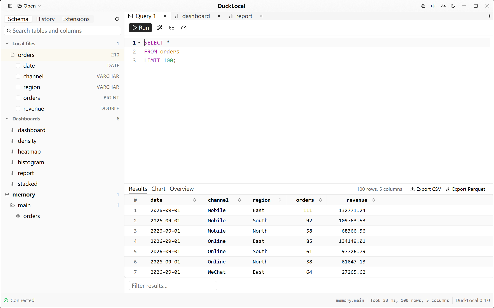

DuckLocal is a native desktop workspace for asking questions of the data files already on your machine. Point it at a CSV, Parquet, JSON, Excel or DuckDB file, or a whole folder, and query it with DuckDB SQL right away. There is no server, no connection to configure and no account, and nothing is uploaded. It is a GPUI app written in Rust, with DuckDB running inside it.

## Open what you already have

Each file appears in the sidebar as a view named after it, with its columns and types. Folders are read recursively, patterns work, workbooks become one table per sheet, and other DuckDB or SQLite databases can be attached next to the ones you have open. Your workspace comes back on the next launch, and S3 buckets can be browsed from the same sidebar.

## Write and run SQL

Query tabs have highlighting, autocompletion, formatting, history, query plans and a profiler that shows where time goes. Results can be filtered, copied, charted, or exported to CSV or Parquet. An Overview tab shows the nulls, distinct values, range and distribution of every column.

## Dashboards as plain files

A dashboard is a small text file of query and plot blocks that lives next to your data. It draws line, bar, stacked bar, area, scatter, pie, heatmap, histogram and map charts, along with tables, metric cards and text panels, and clicking a chart can filter the others. The source view highlights both the dashboard language and the SQL inside it, with completion and inline diagnostics. Dashboard queries can only read, and a language server brings the same checks to other editors.

## Built for AI agents

The same binary runs without a window and answers in structured JSON, so an agent can read a schema, run SQL and validate a dashboard, then hand results to the window you are looking at. An agent can propose a dashboard change for you to review and approve, and a session record shows how an analysis got where it did and what no longer holds. SQL you did not write can run under limits that refuse other files, the network, extensions and writes.

## Comfortable to use

Light and dark themes, four interface sizes, and English and Simplified Chinese. On macOS, Parquet and DuckDB files open from Finder, and Quick Look previews Parquet, DuckDB, CSV, TSV and JSON Lines.

## Status

In active development. Each release includes a signed, notarized build for macOS on Apple silicon and builds for Windows and Linux on x86_64.

[Website](https://ducklocal.app/) · [GitHub repository](https://github.com/JetSquirrel/DuckLocal)
